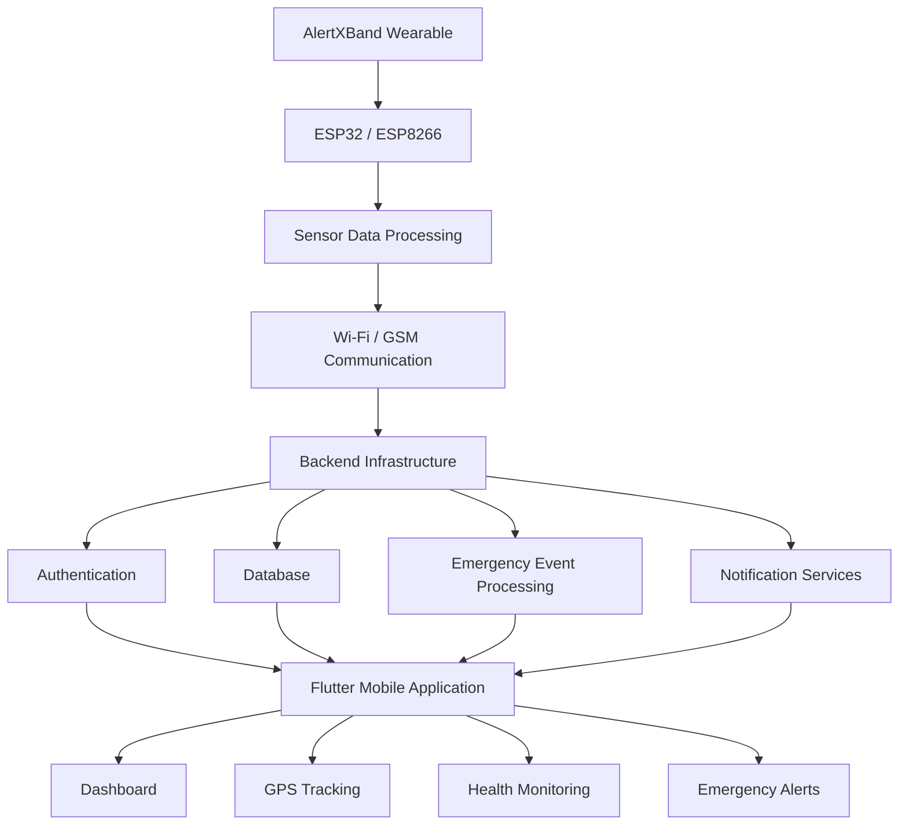

# 🚨 AlertXBand
### AI-Powered Wearable Safety Monitoring & Emergency Alert System

<p align="center">
  <strong>Wearable Technology · IoT · Health Monitoring · GPS Tracking · Emergency Response</strong>
</p>

<p align="center">
  
  
  
  
  
  
</p>

---

## 📌 1. Overview

**AlertXBand** is an IoT-based wearable safety monitoring system designed to support personal safety, health monitoring, location tracking and emergency response through a connected wearable device and mobile application.

The project aims to combine embedded systems, wireless communication, GPS technology, sensor monitoring and mobile application development into a unified safety platform.

The wearable is designed to collect relevant sensor information, identify potential safety events and communicate alerts to a connected mobile application and designated emergency contacts.

The project is being developed in stages, beginning with the Flutter mobile application, followed by backend development and physical hardware integration.

> **Our vision:** Make personal safety monitoring more accessible through intelligent wearable technology and connected emergency response systems.

---

## 🎯 2. Problem Statement

People may encounter emergency situations where they are unable to communicate their location or request assistance quickly.

Traditional emergency communication methods can depend on the user being physically capable of accessing a phone and manually contacting someone.

AlertXBand aims to address these challenges through:

- Wearable-based safety monitoring.
- Automated detection of potential emergency events.
- Location tracking and sharing.
- Emergency SOS functionality.
- Health-related sensor monitoring.
- Mobile notifications and emergency contact management.

---

## 💡 3. Proposed Solution

AlertXBand consists of three primary components:

| Component | Responsibility |
|---|---|
| Wearable Hardware | Collects sensor data and detects configured events. |
| Backend Infrastructure | Processes, stores and distributes device information and alerts. |
| Flutter Mobile Application | Provides monitoring, configuration, location and notification interfaces. |

The intended workflow is:

1. The wearable collects sensor readings.
2. The device processes sensor information.
3. Relevant events are identified by configured detection logic.
4. The wearable communicates information through an available network.
5. The backend receives and processes the information.
6. The mobile application displays readings, status and alerts.
7. Emergency workflows can notify designated contacts when configured and successfully connected.

---

## ✨ 4. Key Features

### 📱 Mobile Application

- User registration and login interface.
- Home dashboard.
- Personal information management.
- Wearable device monitoring.
- Sensor monitoring dashboard.
- Emergency contacts management.
- SOS emergency interface.
- GPS tracking interface.
- Health monitoring interface.
- Notification centre.
- Emergency and alert history.
- Device setup guide.
- Frequently asked questions.
- Troubleshooting guide.
- Problem reporting interface.
- Settings and account management.

### 🛡️ Safety & Emergency Monitoring

Planned capabilities include:

- Emergency SOS activation.
- Fall detection using motion sensors.
- Emergency event processing.
- Location sharing.
- Device connectivity monitoring.
- Emergency contact notification.
- Alert history and event tracking.

### ❤️ Health Monitoring

The hardware design may support:

- Heart-rate monitoring.
- Temperature monitoring.
- Humidity monitoring.
- Motion and activity monitoring.
- Additional sensor-based measurements depending on the hardware configuration.

### 📍 Location Tracking

The proposed GPS functionality includes:

- GPS coordinate acquisition.
- Location updates.
- Device location display.
- Emergency location sharing.
- Location history, subject to implementation.

---

## 🏗️ 5. System Architecture

The planned architecture consists of the wearable, backend and mobile application.



**Architecture note:** This represents the intended system architecture. Backend services and complete hardware-to-application communication are still under development.

---

## 🧰 6. Technology Stack

### Mobile Application

| Technology | Purpose |
|---|---|
| Flutter | Cross-platform application development |
| Dart | Application programming language |
| Material Design | User interface components |
| Riverpod | State management |
| GoRouter | Application navigation |

### Embedded Hardware

| Component | Intended purpose |
|---|---|
| ESP32 / ESP8266 | Main microcontroller |
| MPU6050 | Accelerometer and gyroscope |
| NEO-6M GPS | Location acquisition |
| SIM800L GSM | Cellular communication |
| DHT22 | Temperature and humidity |
| MAX30102 / compatible pulse sensor | Heart-rate sensing |
| MQ-2 | Gas sensing, where applicable |
| OLED / LCD | Local device display |
| Li-ion battery | Portable power supply |

*The final hardware configuration depends on component compatibility, power requirements and prototype validation.*

### Backend — Planned

| Technology | Intended purpose |
|---|---|
| Firebase Authentication | User authentication |
| Cloud Firestore | Application and device data |
| Cloud Functions | Backend event processing |
| Firebase Cloud Messaging | Push notifications |
| Cloud Storage | File and profile image storage |

---

## 📂 7. Project Structure

The Flutter application follows a feature-oriented architecture.

```text
AlertXBand/
│
├── android/
├── windows/
├── test/
│
├── lib/
│   │
│   ├── main.dart
│   │
│   ├── core/
│   │   ├── router/
│   │   └── theme/
│   │
│   ├── features/
│   │   ├── admin/
│   │   ├── authentication/
│   │   ├── dashboard/
│   │   ├── device_monitoring/
│   │   ├── emergency_alerts/
│   │   ├── emergency_contacts/
│   │   ├── gps_tracking/
│   │   ├── health_monitoring/
│   │   ├── notifications/
│   │   ├── onboarding/
│   │   ├── profile/
│   │   ├── settings/
│   │   └── support/
│   │
│   ├── models/
│   ├── providers/
│   ├── services/
│   └── widgets/
│
├── pubspec.yaml
├── analysis_options.yaml
├── .gitignore
└── README.md
```

*The structure is representative of the project organization and may evolve as development continues.*

---

## ⚙️ 8. Getting Started

### Prerequisites

Install the following tools:

- Flutter SDK
- Dart SDK
- Android Studio or Android SDK
- Visual Studio Code
- Git
- An Android device or emulator

### Step 1 — Clone the repository

```bash
git clone YOUR_GITHUB_REPOSITORY_URL
```

### Step 2 — Navigate to the project

```bash
cd AlertXBand
```

### Step 3 — Install dependencies

```bash
flutter pub get
```

### Step 4 — Verify Flutter configuration

```bash
flutter doctor
```

### Step 5 — Run the application

```bash
flutter run
```

### Step 6 — Analyze the project

```bash
flutter analyze
```

---

## 🔌 9. Hardware Integration Roadmap

Hardware integration will be implemented after the mobile application and backend communication interfaces are established.

The proposed integration sequence:

1. Microcontroller initialization.
2. Sensor initialization and calibration.
3. GPS communication and location validation.
4. GSM or Wi-Fi communication.
5. Device authentication.
6. Secure device-to-backend communication.
7. Sensor data transmission.
8. Emergency event transmission.
9. Mobile application synchronization.
10. End-to-end testing.

### Proposed Device Data Format

An example of the intended device communication payload:

```json
{
  "deviceId": "AXB-0001",
  "timestamp": "2026-11-09T10:30:00Z",
  "temperature": 32.1,
  "humidity": 47.4,
  "heartRate": 78,
  "location": {
    "latitude": 13.0827,
    "longitude": 80.2707
  },
  "fallDetected": false,
  "sosTriggered": false,
  "deviceStatus": "online"
}
```

This is an illustrative data contract, not a claim of live hardware transmission.

---

## 📊 10. Development Status

| Development Area | Status |
|---|---|
| Flutter project setup | Implemented |
| Application navigation | In progress |
| Authentication UI | Implemented as demo UI |
| Home dashboard | Implemented |
| Device monitoring UI | Implemented |
| Emergency contacts UI | Implemented |
| GPS tracking UI | Implemented |
| Health monitoring UI | Implemented |
| Notifications UI | Implemented with demo data |
| Help & Support | In progress |
| Account & Security | Pending |
| Privacy Policy | Pending |
| Terms & Conditions | Pending |
| App Permissions | Pending |
| Firebase backend | Planned |
| Device-to-cloud integration | Planned |
| Live hardware data | Pending validation |
| End-to-end testing | Pending |

**Important:** Some interfaces currently use demonstration data or local in-memory state. Their presence does not mean the corresponding production service or physical hardware integration is complete.

---

## 🗺️ 11. Future Development Roadmap

### Phase 1 — Mobile Application
- Complete all remaining screens.
- Finalize navigation and application state.
- Improve validation and error handling.
- Complete UI and responsiveness testing.

### Phase 2 — Backend Infrastructure
- Firebase project configuration.
- Authentication and user profiles.
- Firestore database architecture.
- Device registration.
- Emergency contacts and alert management.
- Secure communication interfaces.

### Phase 3 — Hardware Integration
- ESP32 / ESP8266 firmware.
- Sensor integration and calibration.
- GPS tracking.
- GSM / Wi-Fi connectivity.
- Device authentication.
- Live sensor data transmission.

### Phase 4 — Intelligent Safety Workflows
- Fall detection validation.
- Emergency event processing.
- Notification delivery.
- Location sharing.
- Connectivity monitoring.

### Phase 5 — Testing and Deployment
- Hardware and software integration testing.
- Network failure testing.
- Battery and power testing.
- Security testing.
- User acceptance testing.
- Production deployment preparation.

---

## 🔐 12. Security & Privacy

Security is an important consideration for a wearable safety platform.

Planned security measures include:

- Secure user authentication.
- Device-level authentication.
- Firestore security rules.
- Restricted access to personal information.
- Protected emergency contact information.
- Secure transmission of device data.
- Appropriate access controls for emergency information.

Actual security guarantees will depend on implementation, configuration and testing.

---

## ⚠️ 13. Prototype Disclaimer

AlertXBand is an evolving prototype and development project.

It is not a certified medical device or a validated emergency response system.

Sensor measurements, fall detection, location tracking and emergency notifications must undergo appropriate hardware validation and reliability testing before real-world safety use.

Users should not rely on this prototype as their sole means of emergency communication or medical monitoring.

---

## 🤝 14. Contributions

Contributions, suggestions and technical feedback are welcome.

If you would like to contribute:

1. Fork the repository.
2. Create a feature branch.
3. Implement your changes.
4. Test your implementation.
5. Submit a pull request with a clear description.

---

## 👨‍💻 15. Project Information

| Field | Details |
|---|---|
| Project | AlertXBand |
| Domain | IoT · Wearable Technology · Personal Safety |
| Mobile Framework | Flutter |
| Programming Language | Dart |
| Hardware Platform | ESP32 / ESP8266 |
| Development Stage | Prototype |
| Repository | AlertXBand |

---

## 🌟 16. Vision

AlertXBand aims to bring wearable technology, connected monitoring and emergency response into one integrated platform.

The long-term objective is to develop a reliable, accessible and extensible personal safety solution through continuous software development, hardware experimentation and real-world validation.

**Building technology that helps people feel safer, connected and protected.**

---

<p align="center">
  <strong>ALERTXBAND</strong><br>
  <em>Smart Wearable. Connected Safety. Faster Response.</em>
</p>
