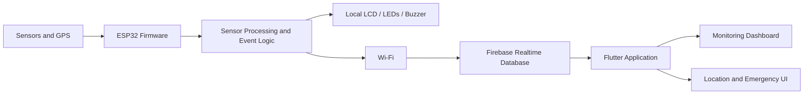

# 🚨 AlertXBand
### Smart Wearable Safety Monitoring & Emergency Alert System

<p align="center">
  <strong>Wearable IoT · Embedded Systems · Flutter · GPS · Firebase</strong>
</p>

<p align="center">
  
  
  
  
  
</p>

---

## Overview

**AlertXBand** is a wearable Internet of Things (IoT) safety monitoring project that combines an ESP32-based device, sensor-based event detection, GPS, cloud connectivity and a Flutter application.

The project is intended to help monitor selected environmental and motion conditions, share device information with a connected application, and support emergency-alert workflows.

AlertXBand is being developed as an integrated hardware-and-software prototype. The repository contains the Flutter application, ESP32 firmware, hardware notes and project documentation.

> **Project vision:** Bring wearable sensing, location awareness and connected emergency communication together in one accessible platform.

## Problem

During an emergency, a person may not be able to reach a phone or manually communicate their situation and location. A wearable device can help by collecting sensor readings, identifying configured events and communicating relevant information to a connected system.

AlertXBand explores this approach through:
- Continuous acquisition of supported sensor readings.
- Motion-based fall-event detection logic.
- GPS coordinate acquisition.
- Local status indications using a display, LEDs and buzzer.
- Wi-Fi connectivity and cloud data transmission.
- A mobile application for monitoring device information.

## System at a glance

AlertXBand is organized into three main parts:

| Layer | Role |
|---|---|
| Wearable device | ESP32, sensors, GPS and local indicators acquire and process device data. |
| Cloud connectivity | Firebase Realtime Database is used by the integrated firmware to transmit device information. |
| Flutter application | Provides the user-facing interface for device monitoring, location, emergency features and account-related screens. |

### Data flow



The diagram represents the current Wi-Fi/Firebase data path in the integrated firmware. GSM/SIM800L communication and complete end-to-end emergency delivery should be treated as separate integration work unless verified in the current build.

## Key capabilities

### Embedded firmware — integrated V1.0

The integrated ESP32 sketch in `firmware/integrated-v1/` includes:

- MPU6050 raw-register motion acquisition.
- Free-fall and impact-based fall-event logic.
- NEO-6M GPS data parsing.
- DHT22 temperature and humidity acquisition.
- MQ-2 gas sensor ADC acquisition.
- Buzzer and red/yellow/green status LED control.
- GPS status LED and 16×2 I2C LCD output.
- Wi-Fi connectivity.
- Firebase Email/Password authentication and token refresh.
- Firebase Realtime Database REST data upload.

### Flutter application

The Flutter application includes screens and flows for:

- Authentication and onboarding.
- Home dashboard and device monitoring.
- Health monitoring interface.
- GPS tracking interface.
- Emergency alerts and emergency contacts.
- Notifications.
- Profile, settings and support.

Some screens or indicators may still use demonstration/simulated data or have integration work remaining. Refer to the current implementation and testing notes before treating an interface as a verified live feature.

## Hardware

The integrated V1.0 firmware currently supports the following connected modules:

| Component | Purpose |
|---|---|
| ESP32 | Main controller |
| MPU6050 / compatible IMU | Acceleration and gyroscope readings |
| NEO-6M GPS | Position data |
| DHT22 | Temperature and humidity |
| MQ-2 | Gas sensor ADC reading |
| 16×2 I2C LCD | Local information display |
| Buzzer and LEDs | Local status and alert indication |

Other modules, including a MAX30102-compatible pulse sensor and SIM800L GSM module, have been explored during development. Check the actual prototype and the relevant firmware before assuming they are part of the integrated V1.0 build.

## Technology stack

| Area | Technology |
|---|---|
| Mobile application | Flutter, Dart |
| State management / navigation | Riverpod, GoRouter |
| Embedded platform | ESP32, Arduino framework |
| Sensor and GPS libraries | TinyGPSPlus, DHT sensor library, LiquidCrystal_I2C |
| Cloud data | Firebase Realtime Database REST API |
| Authentication for device upload | Firebase Email/Password |
| Source control | Git and GitHub |

## Repository structure

```text
AlertXBand/
├── android/                    # Android application platform
├── lib/                        # Flutter application source
├── test/                       # Flutter tests
├── web/                        # Flutter web platform
├── windows/                    # Flutter Windows platform
├── functions/                  # Firebase/backend functions
├── firmware/
│   ├── integrated-v1/
│   │   ├── AlertXBand_V1.0.ino
│   │   └── README.md
│   ├── config.example.h
│   └── docs/
├── hardware/
│   ├── components-list.md
│   ├── circuit-connections.md
│   ├── power-management.md
│   └── hardware-testing.md
├── docs/
│   ├── system-architecture.md
│   └── testing-and-validation.md
├── pubspec.yaml
└── README.md
```

The tree highlights the main project areas; individual files and folders may evolve during development.

## Getting started — Flutter application

### Requirements

- Flutter SDK and Dart SDK
- Android Studio / Android SDK or Visual Studio Code
- Git
- Android emulator or compatible device

### Setup

1. Clone the repository:

   ```bash
   git clone https://github.com/sangamesh-mk/AlertXBand.git
   ```

2. Open the project directory:

   ```bash
   cd AlertXBand
   ```

3. Install Flutter dependencies:

   ```bash
   flutter pub get
   ```

4. Check the local Flutter environment:

   ```bash
   flutter doctor
   ```

5. Run the application:

   ```bash
   flutter run
   ```

Firebase configuration may be required for features that use connected Firebase services. Do not commit private configuration files or credentials.

## Getting started — ESP32 firmware

The integrated firmware and its setup instructions are maintained here:

- [Integrated V1.0 firmware](firmware/integrated-v1/AlertXBand_V1.0.ino)
- [Firmware setup guide](firmware/integrated-v1/README.md)
- [Example configuration](firmware/config.example.h)

The sketch requires a local `config.h` containing your own Wi-Fi and Firebase values. Create it from the example configuration and keep it out of version control. Never publish Wi-Fi passwords, Firebase device-account passwords, API keys or access tokens.

## Development status

| Area | Current status |
|---|---|
| Flutter application structure and core screens | Implemented |
| ESP32 integrated V1.0 sketch | Added to repository |
| MPU6050, GPS, DHT22 and MQ-2 firmware acquisition | Implemented in V1.0 sketch |
| Local LCD, buzzer and LED outputs | Implemented in V1.0 sketch |
| Wi-Fi and Firebase RTDB upload in firmware | Implemented in V1.0 sketch |
| Live sensor data in application | Hardware data has been observed in the application; continue validating individual fields and refresh behavior |
| Live GPS display in application | Integration/validation remains |
| Consistent live-data status across all screens | Requires further integration |
| Event-driven alerts and notifications | Requires end-to-end validation |
| GSM calling/SMS workflow | Not claimed as complete in integrated V1.0 |
| Full emergency workflow reliability | Requires further validation |

This status table distinguishes code present in the repository from features that still need complete application-level or end-to-end validation.

## Documentation

- [System architecture](docs/system-architecture.md)
- [Testing and validation](docs/testing-and-validation.md)
- [Hardware documentation](hardware/README.md)
- [Component list](hardware/components-list.md)
- [Circuit connections](hardware/circuit-connections.md)
- [Power management](hardware/power-management.md)
- [Hardware testing notes](hardware/hardware-testing.md)
- [Firmware documentation](firmware/README.md)
- [Prototype photo gallery and demo video](docs/prototype-gallery.md)
- [AlertXBand project presentation (PowerPoint)](presentation/AlertXBand-Project-Presentation.pptx)
## Roadmap

- Complete live GPS integration in the Flutter application.
- Ensure all monitoring screens consistently distinguish live hardware data from simulated data.
- Complete event-driven alert and notification workflows.
- Validate sensor thresholds and fall-detection behavior under controlled test conditions.
- Finalize hardware wiring diagrams and prototype documentation.
- Validate network-loss behavior, power consumption and battery runtime.
- Review Firebase access rules and transport security before deployment.
- Prepare a tagged project release after end-to-end verification.

## Security and safety

- Keep local `config.h`, passwords, API keys and tokens out of Git.
- Restrict Firebase access using appropriate authentication and database rules.
- The current firmware uses `WiFiClientSecure::setInsecure()` for initial testing. Proper TLS certificate validation is required before deployment.
- Calibrate the MQ-2 threshold for the actual sensor and environment; its ADC threshold is not a gas concentration measurement.
- Validate fall-detection thresholds and event timing against representative movements and false-positive/false-negative cases.
- Review battery protection, charging, regulator sizing and wiring before extended operation.

## Disclaimer

AlertXBand is an engineering prototype and is **not a certified medical device or a guaranteed emergency response system**. Sensor readings, fall detection, GPS accuracy and notification delivery can be affected by hardware, environment, network coverage, power and software conditions.

Do not rely on this prototype as the sole means of emergency communication, medical monitoring or personal protection.

## Contributing

Technical feedback and contributions are welcome.

1. Fork the repository.
2. Create a feature branch.
3. Make a focused change.
4. Test the change and document relevant results.
5. Open a pull request describing the implementation and validation.

## Project information

| Field | Details |
|---|---|
| Project | AlertXBand |
| Domain | Wearable IoT and personal safety |
| Application | Flutter |
| Firmware | ESP32 / Arduino |
| Cloud data | Firebase Realtime Database |
| Stage | Working prototype under development |
| Repository | [sangamesh-mk/AlertXBand](https://github.com/sangamesh-mk/AlertXBand) |

---

<p align="center">
  <strong>ALERTXBAND</strong><br>
  <em>Smart Wearable. Connected Safety. Faster Response.</em>
</p>
